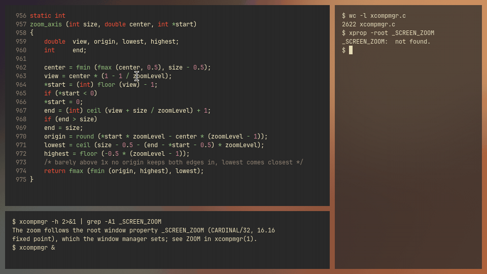

# xcompmgr-zoom

xcompmgr-zoom is [xcompmgr](https://gitlab.freedesktop.org/xorg/app/xcompmgr),
the sample compositing manager for X, with a zoom for the whole desktop: it
magnifies the whole screen around the pointer, as macOS does, when a root
window property asks it to. Everything else is xcompmgr 1.1.10 as upstream
has it.

<p></p>

## Zoom

Set the zoom level on the root window and xcompmgr eases toward it in about a
quarter of a second, keeping the pixel under the pointer where it is. Clicks
need no translation, the cursor keeps its normal size, and as you move the
pointer the view follows it across the desktop.

The level lives in the root window property `_SCREEN_ZOOM`: CARDINAL, format
32, one value, the magnification in 16.16 fixed point. No property, or a value
of 65536 (1x) or less, means no zoom, and anything above 16x counts as 16x.
[rxcom](https://github.com/crazyboycjr/rxcom) reads the same property, so the
same bindings drive either. From a shell:

```sh
xprop -root -f _SCREEN_ZOOM 32c -set _SCREEN_ZOOM 131072   # 2x
xprop -root -remove _SCREEN_ZOOM                           # back to 1x
```

This script, `zoom-step`, zooms in or out by 1.2x each time it runs. Bind
`zoom-step in`, `zoom-step out` and `zoom-step off` to keys with sxhkd,
xbindkeys or your window manager:

```sh
#!/bin/sh
# zoom-step in|out|off: zoom the desktop in or out by 1.2x, within 1x to 16x.
z=$(xprop -root _SCREEN_ZOOM | sed -n 's/.* = //p')
case $1 in
in) z=$((${z:-65536} * 6 / 5)) ;;
out) z=$((${z:-65536} * 5 / 6)) ;;
*) z=0 ;;
esac
if [ "$z" -le 65536 ]; then
	xprop -root -remove _SCREEN_ZOOM
else
	xprop -root -f _SCREEN_ZOOM 32c -set _SCREEN_ZOOM $((z < 1048576 ? z : 1048576))
fi
```

In xmonad, as key bindings:

```haskell
import XMonad
import XMonad.Util.EZConfig (additionalKeys)

-- | Multiply the desktop zoom by f, within 1x to 16x; xcompmgr eases toward it.
zoomBy :: Double -> X ()
zoomBy f = withDisplay $ \dpy -> do
    root <- asks theRoot
    atom <- getAtom "_SCREEN_ZOOM"
    prop <- io $ getWindowProperty32 dpy atom root
    let current = case prop of
            Just [v] -> fromIntegral v / 65536
            _ -> 1
        target = max 1 (min 16 (current * f))
    io $ changeProperty32 dpy root atom cARDINAL propModeReplace [round (target * 65536)]

main :: IO ()
main = xmonad $ def
    `additionalKeys`
        [ ((mod4Mask, xK_equal), zoomBy 1.2)       -- Super and =: in
        , ((mod4Mask, xK_minus), zoomBy (1 / 1.2)) -- Super and -: out
        , ((mod4Mask, xK_0), zoomBy 0)             -- Super and 0: off
        ]
```

By default every pixel of the magnified screen is a sharp block, which shows
exactly what is drawn; `-z linear` smooths it with X Render's bilinear filter
instead. The zoom needs client-side compositing, so it does nothing with `-a`.
The ZOOM section of `man xcompmgr` has the details.

Only the final copy of the composed screen changes: while zoomed it is one
Composite through a scaling transform, so windows are still painted only where
damaged. The mapping is the one picom-zoom and rxcom use, and on a nested Xvfb
the zoomed frames match it pixel for pixel at 1.2x, 2x, 4x and 16x. While
zoomed, xcompmgr asks for the pointer every 4 ms and draws a frame only when it
moved or the level changed, so a resting pointer costs nothing.

## Why

picom with a zoom patch waits on an X Sync fence after every frame, and
NVIDIA's X driver sometimes never wakes that wait, which froze the desktop.
xcompmgr uses neither fences nor GL, so the zoom was ported to it. Like
xcompmgr itself, it may tear unless the driver keeps the screen tear-free, as
NVIDIA's ForceFullCompositionPipeline does. rxcom, a compositor in Rust written
around the same zoom, adds unredirection for games and experimental GL and
Vulkan presenters.

## Build

You need meson, xorgproto and the X libraries xcompmgr has always needed:
libX11, libXcomposite, libXdamage, libXext, libXfixes and libXrender.

```sh
meson setup build
meson compile -C build
meson install -C build
```

**Arch Linux.** `packaging/arch/PKGBUILD` builds the checkout it sits in and
stands in for xcompmgr; an AUR package `xcompmgr-zoom` is to come.

```sh
git clone https://github.com/crazyboycjr/xcompmgr-zoom
cd xcompmgr-zoom/packaging/arch
makepkg -si
```

## Upstream

xcompmgr lives at https://gitlab.freedesktop.org/xorg/app/xcompmgr, and
questions about it go to the Xorg mailing list,
https://lists.x.org/mailman/listinfo/xorg. Report problems with the zoom here.
The license is xcompmgr's, in [COPYING](COPYING), unchanged.
